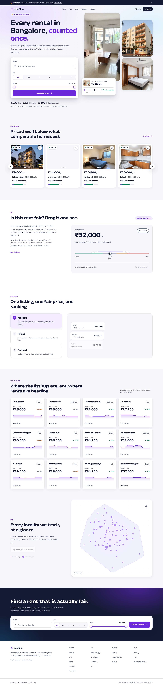

# Roofline

**Last Updated:** 2026-10-16

Roofline is a rental-market explorer for Bangalore, built by adhikbuilds. v1 runs entirely on a fictional synthetic seed: no real listings, no scraped data, no third-party portal content. Five fictional sources (NestLane, RentBarn, KeyLoft, DoorVale, HearthGrid) feed a deterministic ingestion pipeline, and the web app shows what it accepted, with honest counts.



## Engineering choices

- **A pure engine.** `@roofline/engine` does no I/O and uses no clock or randomness. Every derived value is stamped with `ENGINE_VERSION`, so results are reproducible and easy to test.
- **Seven pipeline stages:** fetch, normalize, canonicalize locality, quality, persist, dedup, then fair rent and deals. Each weekly ingest runs as one database transaction, so every source is judged against the same statistical baseline.
- **Robust data quality.** Hard rules come first. Then an outlier test based on median absolute deviation (MAD) runs against per-locality rent bands. Every rejection carries a reason code, and anything kept despite a problem carries a warning code.
- **Locality resolution:** exact alias match, then Jaro–Winkler fuzzy match, then nearest PostGIS centroid.
- **Dedup across sources.** Listings are grouped into candidate blocks, pairs are scored, and clusters are formed with guards against chaining. Merged listings get stable ids, and old ids redirect to them.
- **Honest data.** v1 runs on a synthetic seed with planted defects, so the quality and dedup stages can be measured against known ground truth.

Documentation:

- [docs/architecture.md](docs/architecture.md): packages, codemap, boundaries, database roles
- [docs/methodology.md](docs/methodology.md): ingestion stages, quality rules, MAD thresholds, reason codes
- [docs/data-provenance.md](docs/data-provenance.md): synthetic generator, fictional sources, ground-truth schema, planted defects, determinism
- [PLAN.md](PLAN.md): product scope, phased build plan and acceptance criteria
- [CLAUDE.md](CLAUDE.md): working rules for contributors and agents

## Prerequisites

- Node.js 24 (`engines` asks for 20 or newer; `pnpm preflight` enforces 20+)
- pnpm 10.33.0 (`corepack enable` picks up the `packageManager` pin)
- Docker Desktop or OrbStack (Postgres 16 with PostGIS, host port 5432)

Ports are fixed: web on 3000, Postgres on 5432. `pnpm preflight` fails loudly if something else holds 5432.

## Quick start

Run these from the repository root.

```bash
pnpm install                 # install the workspace (apps/web, packages/*)
cp .env.example .env.local   # only if .env.local does not exist (the local DSNs are already set)
pnpm preflight               # Node, pnpm, Docker and port checks
pnpm db:up                   # start Postgres + PostGIS (docker compose, waits for healthy)
pnpm db:fresh                # drop schemas, migrate, load reference data, seed 26 weekly runs
pnpm dev                     # web app on http://localhost:3000
pnpm verify                  # typecheck, lint, boundary check, brand guard, all tests
```

Notes:

- `.env.local` is required before `pnpm db:fresh`. `DATABASE_URL` must point at a local database: `db:reset` refuses any non-local host. `.env.example` already contains the local DSNs.
- `pnpm db:fresh` is destructive for the local database. It drops `public` and `seed_truth`, then rebuilds. Use `pnpm db:reset` only if you want the schemas dropped and nothing re-applied.
- `pnpm db:seed` on its own refuses to run when synthetic runs already exist. Use `pnpm db:fresh` to rebuild.
- `pnpm ingest:run` writes to the database (it runs one weekly ingest, week 0 by default). It is not part of the quick start, and `pnpm db:fresh` is the supported way to rebuild the seed.
- `pnpm verify` includes integration tests. Those need the database from `pnpm db:up` and `DATABASE_URL_TEST` (database `roofline_test`, created on first volume init).
- On Apple Silicon, if the `postgis/postgis:16-3.5` image has no arm64 manifest, build the local fallback image instead: `ROOFLINE_PG_BUILD=local docker compose up -d --build --wait`. The compose file does not read `ROOFLINE_PG_BUILD`; the `--build` flag is what builds `packages/db/docker/Dockerfile`. Run `pnpm db:fresh` after either variant.

## Common commands

| Command | What it does |
|---|---|
| `pnpm dev` | Next.js 15 dev server on port 3000 |
| `pnpm build` | Production build of `apps/web` |
| `pnpm test` | Script tests, then every package's vitest suite |
| `pnpm typecheck` | `tsc --noEmit` in every package |
| `pnpm lint` | ESLint in every package that has a lint script |
| `pnpm check:boundaries` | dependency-cruiser: engine purity and package boundaries |
| `pnpm brand-guard` | Fails if a banned reference-product name appears outside exempt files |
| `pnpm e2e` | Playwright tests for `apps/web` |
| `pnpm db:up` / `pnpm db:down` | Start / stop Postgres |
| `pnpm db:migrate` | Apply numbered SQL migrations (checksum-verified) |
| `pnpm db:reset` | Drop and recreate the `public` and `seed_truth` schemas (local only) |
| `pnpm db:seed` | Reference data plus the 26-week synthetic seed |
| `pnpm db:check-drift` | Compare the database schema with the Drizzle definitions |
| `pnpm --filter @roofline/ingest eval:quality` | Compare pipeline rejections with the planted defects |
| `pnpm --filter @roofline/ingest eval:dedup` | Pairwise and B-cubed metrics of the dedup clustering against the planted units (also `pnpm eval:dedup`) |
| `pnpm preflight` | Environment checks |
| `pnpm screens` | Headless screenshot helper for `docs/screens/` |

`pnpm verify` runs, in order: `typecheck`, `lint`, `check:boundaries`, `brand-guard`, `test`, `test:scripts`.

## Repository layout

```
apps/web/              Next.js 15 app (App Router, React 19, Tailwind v4)
packages/engine/       Pure domain logic: normalize, locality, geo, stats, quality, trace, flags
packages/db/           SQL migrations, Drizzle schema, query modules, reference data, docker
packages/ingest/       Source adapters, the synthetic generator, pipeline stages 1-4, CLI, evals
scripts/               preflight, brand-guard, screens
docs/                  architecture, methodology, data provenance, screenshots, recon notes
```

## Environment

`.env.example` lists every variable. The ones that matter for local development:

| Variable | Default in `.env.example` | Purpose |
|---|---|---|
| `DATABASE_URL` | local `roofline` database | Application and admin connection |
| `DATABASE_URL_TEST` | local `roofline_test` database | Integration tests |
| `AUTH_SECRET`, `IP_HASH_SALT` | empty | Reserved for the accounts and rate-limit phases. No code reads them yet |
| `ROOFLINE_DATA_MODE` | `synthetic` | `synthetic` (default) or `licensed`. v1 ships only the synthetic adapter, so `licensed` has no source yet |
| `ANTHROPIC_API_KEY` | empty | Optional. The app must work without it |

Secrets live in `.env.local`, which is gitignored. Never commit keys or real personal data.

## Legal and data

- All v1 data is generated. See [docs/data-provenance.md](docs/data-provenance.md).
- Adapters for licensed feeds and owner submissions are the only route to non-synthetic data, and each needs a written licence first.
- Images are generated SVG plates, not photographs.
